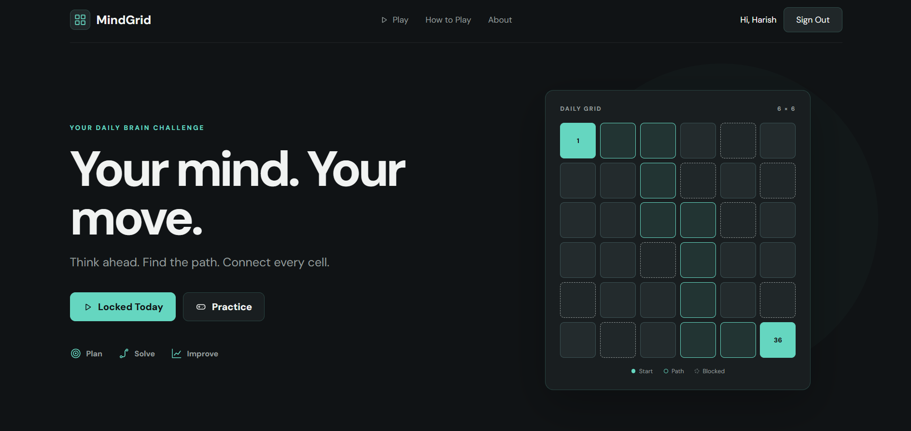
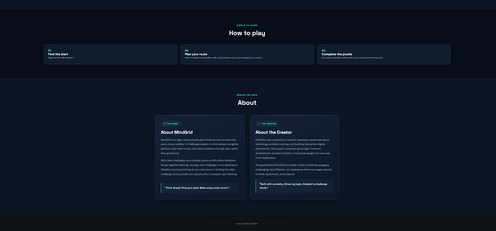
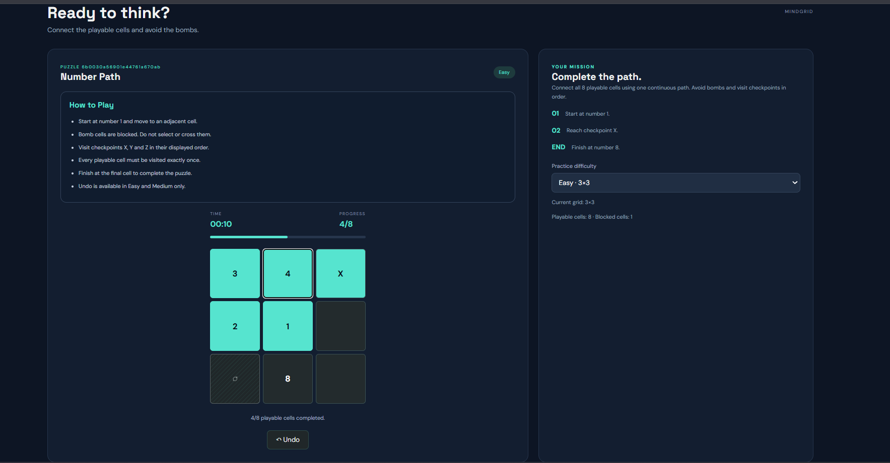
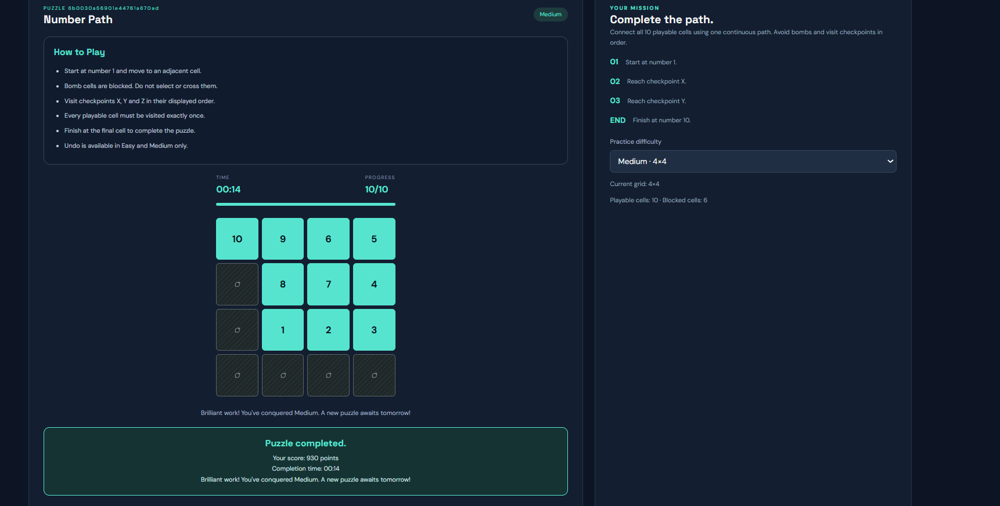
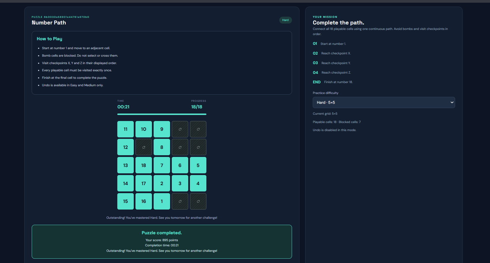

<div align="center">

# MindGrid

### Think ahead. Find your path. Make every move count.

**A daily grid-based path puzzle game built around planning, checkpoints, and careful moves.**

[](https://react.dev/)
[](https://vite.dev/)
[](https://nodejs.org/)
[](https://expressjs.com/)
[](https://www.mongodb.com/)
[](https://github.com/Harishcreator123/MindGrid/releases)

<br />

[**▶ Play the Live Demo**](https://mind-grid-rose.vercel.app/) ·
[View the source on GitHub](https://github.com/Harishcreator123/MindGrid)

</div>

---

## Contents

- [About](#about)
- [Features](#features)
- [Screenshots](#screenshots)
- [Gameplay Demo](#gameplay-demo)
- [Tech Stack](#tech-stack)
- [Architecture](#architecture)
- [Project Structure](#project-structure)
- [Run Locally](#run-locally)
- [Planned Improvements](#planned-improvements)
- [Credits](#credits)

## About

MindGrid is a logic-based path puzzle played on a grid. Build one continuous route through playable cells, visit checkpoints in order, avoid bomb cells, and reach the finish. Each move affects the route ahead, so planning matters.

The project is a full-stack web application with a React and Vite frontend, an Express API, and MongoDB persistence.

## Features

- **Four game modes:** Easy (3×3), Medium (4×4), Hard (5×5), and Challenge (6×6).
- **Daily puzzles:** Play the current puzzle for a selected mode.
- **Practice modes:** Work through Easy, Medium, and Hard at your own pace.
- **Ordered checkpoints:** Visit the marked checkpoints in sequence.
- **Bombs:** Avoid bomb cells while planning your route.
- **Authentication:** Register an account and sign in to access server-backed puzzles.
- **Progress tracking:** Daily mode progress and attempt status are stored with the account.
- **Challenge resume:** In-progress Challenge routes can be resumed.
- **Timer and scoring:** See elapsed time and the score associated with an attempt.
- **Responsive UI:** Play on different screen sizes.

## Screenshots

Screenshots below are stored at the repository root.

<table>
  <tr>
    <td align="center">
      <strong>Landing Page</strong><br />
      <a href="./01-mindgrid-homepage.png">
        
      </a>
    </td>
    <td align="center">
      <strong>How to Play and About</strong><br />
      <a href="./02-mindgrid-how-to-play-about.png">
        
      </a>
    </td>
  </tr>
  <tr>
    <td align="center">
      <strong>Daily Challenge and Practice</strong><br />
      <a href="./03-mindgrid-daily-practice.png">
        
      </a>
    </td>
    <td align="center">
      <strong>Medium Completed</strong><br />
      <a href="./04-mindgrid-medium-completed.png">
        
      </a>
    </td>
  </tr>
  <tr>
    <td align="center">
      <strong>Hard Completed</strong><br />
      <a href="./05-mindgrid-hard-completed.png">
        
      </a>
    </td>
    <td></td>
  </tr>
</table>

## Gameplay Demo

No gameplay video is currently stored in this repository, and no verified hosted video URL is available to link here.

## Tech Stack

| Area | Technologies |
| --- | --- |
| Frontend | React, Vite, CSS |
| Backend | Node.js, Express |
| Database and data access | MongoDB, Mongoose |
| Authentication | JSON Web Tokens (JWT) |
| Deployment | Vercel, Render |

## Architecture

MindGrid is organized as a client application and an Express API:

1. The **React/Vite frontend** renders the game and sends HTTP requests through the client API helper.
2. The **Express backend** exposes `/api/auth` and `/api/game` routes. Protected game requests use the account’s JWT.
3. **Server services and generators** create and validate puzzles and handle game progress.
4. **MongoDB**, accessed through Mongoose, stores users, daily puzzles, and per-user daily progress.

Daily date keys are calculated using the `America/Los_Angeles` timezone. The browser’s API base URL can be configured with `VITE_API_URL`; it defaults to `http://localhost:5000`.

## Project Structure

```text
MindGrid/
├── 01-mindgrid-homepage.png
├── 02-mindgrid-how-to-play-about.png
├── 03-mindgrid-daily-practice.png
├── 04-mindgrid-medium-completed.png
├── 05-mindgrid-hard-completed.png
├── client/
│   ├── public/
│   └── src/
│       ├── assets/
│       ├── App.jsx
│       ├── App.css
│       ├── Auth.jsx
│       ├── api.js
│       ├── gameEngine.js
│       └── main.jsx
├── server/
│   ├── generators/
│   ├── middleware/
│   ├── models/
│   ├── routes/
│   ├── scripts/
│   ├── services/
│   ├── tests/
│   └── server.js
└── README.md
```

## Run Locally

### Prerequisites

- Node.js **20.19+** or **22.12+**, and npm.
- A MongoDB instance and its connection URI.

### 1. Clone the repository

```bash
git clone https://github.com/Harishcreator123/MindGrid.git
cd MindGrid
```

### 2. Configure and start the backend

```bash
cd server
npm install
```

Create `server/.env` with your own values:

```dotenv
PORT=5000
MONGODB_URI=<your-mongodb-connection-uri>
JWT_SECRET=<your-long-random-secret>
JWT_EXPIRE=7d
```

`MONGODB_URI` and `JWT_SECRET` are required. `PORT` defaults to `5000`, and `JWT_EXPIRE` defaults to `7d`.

Start the API:

```bash
npm run dev
```

The server also provides `npm start` for running `node server.js`. To ensure the current date’s puzzles from the server directory, run:

```bash
npm run seed:daily
```

### 3. Configure and start the frontend

Open a second terminal from the repository root:

```bash
cd client
npm install
npm run dev
```

Vite serves the frontend at `http://localhost:5173` by default. The API URL defaults to `http://localhost:5000`. If your backend uses a different address, create `client/.env.local`:

```dotenv
VITE_API_URL=http://localhost:5000
```

Replace the example URL if needed. Do not commit real credentials or secret values.

### Tests

Run the server tests from the server directory:

```bash
node --test
```

## Planned Improvements

Ideas for future work—not features currently promised by this release:

- Add browser-based end-to-end tests for core puzzle flows.
- Expand accessible keyboard and assistive-technology testing.
- Explore additional progress summaries for players.

## Credits

Created by [Harishcreator123](https://github.com/Harishcreator123).

**Release:** v1.0.0 — First Stable Release

**Live Demo:** [mind-grid-rose.vercel.app](https://mind-grid-rose.vercel.app/)
